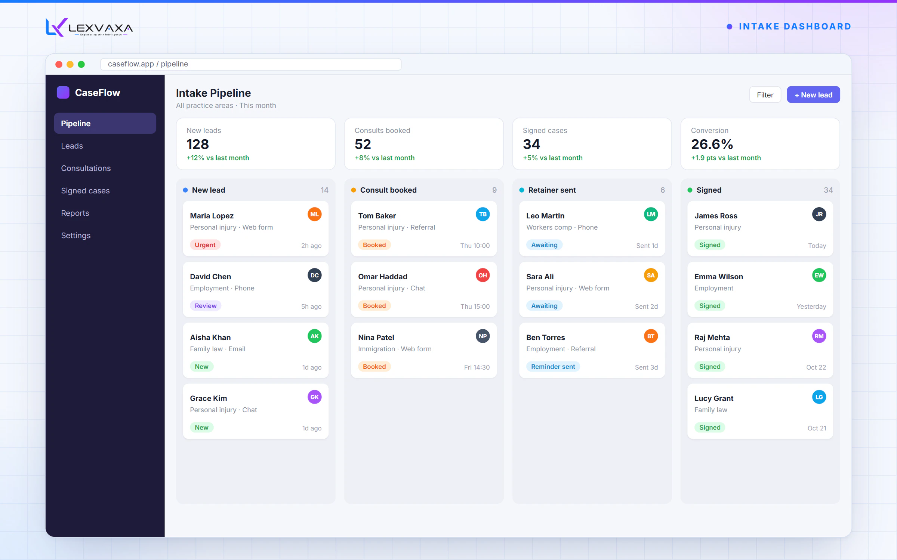

<!-- styled:v2 -->

**A React dashboard that follows every lead from first contact to signed case, with live intake KPIs and a pipeline board by stage and owner.**

  
  
  
  
  
  
  
  

  <a href="#overview">Overview</a> ·
  <a href="#key-features">Key features</a> ·
  <a href="#results">Results</a> ·
  <a href="#tech-stack">Tech stack</a>

---

## Overview

Partners had no single view of new leads, consultations and signed cases, so intake numbers lived in spreadsheets. Lexvaxa built CaseFlow, a custom web dashboard connected to the firm's case data through the Clio API. It shows live KPIs for new leads, consults booked, signed cases and conversion rate, the weekly trend of leads against signed cases, cases by practice area and lead source, and a pipeline board by stage and owner. Screens shown use sample data, so no client records are exposed.

## The challenge

Intake performance was only visible in month-end spreadsheets, too late to act on.

## The solution

n8n syncs leads and matters from Clio and other sources into Supabase, and a React app shows the pipeline and conversion numbers live, with OpenAI tagging lead details.

## Key features

- Live KPIs: new leads, consults, signed cases, conversion
- Pipeline board from new lead to signed
- Weekly leads against signed cases
- Cases by practice area and lead source
- Pipeline table by stage and owner
- Urgency and status tags on each lead

## Results

- Partners see intake performance live and act on it the same day

## Tech stack

      

## Demo

A working version of the dashboard UI with **sample data** is in [`demo/index.html`](demo/index.html). Download it and open it in a browser; it has no build step.

## Privacy

Client names and records are confidential. Every screen in this repository uses sample data, and source code that belongs to the client is not published.

## Links

- Case study on Lexvaxa: https://lexvaxa.com/work/law-firm-intake-case-pipeline

---

**Built by [Ch Muhammad Samiullah](https://github.com/samiullah156-creator)** · AI Automation Engineer and Full-Stack Developer at [Lexvaxa](https://lexvaxa.com)

⭐ Star this repo if you found it useful

